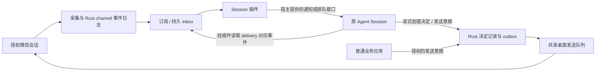

# 微信通道：订阅、应用发件与 Session 插件

wx-cli 提供微信消息、订阅进度和发送队列。普通业务应用可以直接提交发送意图；Session 插件也是调用方，另外负责与 Agent 宿主衔接。订阅或发送都不要求 wx-cli 创建、恢复或持有模型会话。此边界依据 2026-11-03 的用户澄清；当前代码和实测状态见[实施记录](MULTI_CONVERSATION_IMPLEMENTATION.md)。

## 一条消息怎样到达 Session

这张图回答“谁保存微信消息，谁让原 Session 获得消息”：



采集器先把事件保存到 channel。插件即使离线，事件和待处理批次仍保留；插件重新连接后从原进度续读。插件通知 Session 有待办，Session 再取得这一批消息并处理。通知成功不代表已处理，模型回答也不会直接成为微信消息。

Session 的模型、上下文、工具和忙闲状态由 Agent 宿主拥有。插件可以使用宿主支持的事件回调、消息队列或轮询入口；wx-cli 不规定某一种宿主，也不把 `thread/resume` 当成订阅协议。现有 Codex app-server 适配器是一种可选接入实验。

## 普通应用也能向群发消息

普通应用可以只使用发送能力，无需订阅消息或经过 Session 插件。例如，业务系统在自身事务完成后，提交一条给已授权群的通知。应用提供明确的 conversation ID、稳定 request ID 和正文；通道冻结意图、返回排队状态，再由共享桌面执行器切换到目标群发送。应用按原 request ID 查询结果，不因排队或超时创建第二条同义通知。

现有高层入口已经可由应用以子进程调用，正文走 stdin、结果为 JSON；项目中它的可执行名是 `wx-agent`，同属 wx-cli 通道实现，不要求启动模型：

```sh
wx-agent conversations --config /ABS/private/conversations.json send \
  --id CONVERSATION --owner CURRENT_OWNER --expected-epoch EPOCH \
  --request-id app-notification-001 --text-stdin --no-wait < /ABS/private/message.txt
wx-agent dispatch --config /ABS/private/conversations.json status
```

多个应用和 Session 插件共用原 outbox、dispatch 和桌面执行器；不各自建立 GUI 发送器。文字队列、切换会话及幂等保护已有[实机证据](MULTI_CONVERSATION_IMPLEMENTATION.md)；这不是对任何业务应用接入都已验收的承诺。图片队列仍按本轮决定后置。

当前发送约束是会话既有 owner 和 epoch，owner 是协作身份而非应用凭证；调用方不能为了发通知临时替换会话 owner。后续的独立应用身份及按群发送范围应由接入层表达，与收件业务 owner 分开；获得发送权限不同时授予读取和处理消息的权限。现有同机可信应用可复用获准的 CLI 入口，面向独立远程应用的鉴权发送 API 尚未实现，不能把上游查询 HTTP 服务当成该发送 API。

## 两部分各自负责什么

| 责任 | wx-cli / 通道服务 | Session 插件 / Agent 宿主 |
| --- | --- | --- |
| 微信身份与事件 | 核对稳定会话身份，增量采集，持久事件与附件引用 | 仅按获准的会话和事件范围读取 |
| 订阅 | 保存流游标、持久待办、owner、处理租约和控制代际 | 将订阅映射到确切的本地或远端 Session |
| 会话唤醒 | 提供可重读的通知/待办数据 | 使用宿主的通知机制；忙时等待，断线后续接 |
| 业务处理 | 校验 lease/epoch，保存 skip、defer、draft、reply 及来源 | 组织上下文、调用工具、作出明确决定 |
| 发送 | 冻结原意图，幂等入队，串行切换目标，保存 attempt 和结果 | 按授权提交意图并查询同一 request ID |
| 未知与恢复 | 保留原事件、意图、attempt 和待办，拒绝失效写入 | 核对原通知/宿主回执；不换 Session 或请求 ID 绕过 |

Rust 保存权威消息和业务状态。插件只保存连接、宿主路由及可核查的传输引用，不另建一份消息、消费或 outbox 账本。命名的 channel `session_id` 是现有通道绑定字段，与 Agent 的 thread/Session ID 不是同一对象。

## 代码与部署如何分开

先在现有仓库中保持两个独立模块和入口，不为划分职责立即拆成两个仓库。通道端只依赖 Rust、确定性 Python 编排和微信桌面助手；插件依赖通道的版本化 JSON/CLI 合同以及某一种 Agent 宿主接口。更换 Session 宿主不应修改微信采集器、consumer 或 outbox。

微信宿主运行采集和桌面执行器；Session 插件运行在有权接触原 Session 的宿主中。同机时可直接调用 CLI，异机时使用已认证连接。两者分别启动、停止、升级：通道安装不启动模型，插件安装不启用回复；Python 或插件升级不重建已授权的原生助手。

当前代码中的 `inbox.py` 仍把采集循环和可选 Codex 推送编排放在同一文件，`session_adapter.py` 也只实现受管 Codex。后续应把提供商专用编排移入接入模块，保留已有 CLI 的兼容入口；文件移动本身不能算插件完成。真正的拆分验收是：不安装/启动 Codex 时通道订阅仍可用，插件可以独立接合成通道测试，停止插件不丢消息也不改变发送状态。

## 现有订阅入口可以独立使用

下列命令已经存在，示例路径和名称均为占位符。先核实通道绑定和当前订阅进度，再订阅；不为了重新接入而从零确认历史。

```sh
wx-cli channel --state-dir /ABS/private/channel-a status --consumer plugin-reader-a
wx-cli channel --state-dir /ABS/private/channel-a subscribe \
  --consumer plugin-reader-a --poll-ms 1000 --once
```

`subscribe` 从已确认游标之后输出 NDJSON；去掉 `--once` 会持续采集和输出。输出本身不推进持久 consumer。订阅进程退出前未确认的事件，在重新订阅时会再次出现；插件必须以 channel/cursor/事件版本识别重复通知。

底层流的确认命令是 `channel ack --consumer … --cursor … --expected-cursor …`，只确认该 consumer 的流进度。它不代表 Session 已处理、微信已发送或对方已收到。只读观察者可有独立 consumer；同一会话的业务写入仍由一个 owner 和处理租约协调，不能让多个观察订阅者同时自动回复。

需要持久业务待办、忙闲协调和显式决定时，插件复用现有 coordinator inbox：

```sh
wx-agent inbox --config /ABS/private/conversations.json status --id CONVERSATION
wx-agent inbox --config /ABS/private/conversations.json claim \
  --id CONVERSATION --owner subscription-owner-a
wx-agent inbox --config /ABS/private/conversations.json show \
  --delivery-id DELIVERY --owner subscription-owner-a
wx-agent inbox --config /ABS/private/conversations.json events \
  --delivery-id DELIVERY --owner subscription-owner-a --limit 50
```

`events` 限定于已冻结 delivery 的范围。插件使用原领取的 token 提交决定；读、通知和宿主完成回合均不能代替 `inbox complete`。详细决定及发送命令见[托管指南](MANAGED_CONVERSATIONS.md)。现有 `input=push` 表示为 owner 产生可投递待办，不授予回复权限，也不要求绑定 Codex；`reply_policy` 独立控制发送。

## 插件接入应遵守的合同

插件注册时明确 conversation、consumer/owner、宿主和原 Session 引用，不依赖当前界面选中项。路由到另一个 Session 或变更业务 owner 是显式配置变化，必须保留历史并更新控制代际。

通知只需携带稳定的 delivery、conversation、cursor 范围与附件引用。正文按需从该范围读取，lease token 不进入模型提示或普通日志。插件先检查该 delivery 的原状态再通知；宿主正忙时保留待办，不抢开第二个回合。投递结果未知时核对原宿主回执，不能因超时重复创建回合。

有四种不同的结果需要分别核对：

1. 事件已保存，订阅可以重读。
2. 指定宿主/原 Session 收到通知，有对应传输证据。
3. Session 通过原 delivery 显式保存处理决定。
4. 如果决定发送，原 request 的发送结果已保存；独立收件另有证据。

插件安装不默认开启回复或后台模型。Session 使用者可以主动查消息，也可以显式启用其插件监听。插件停止或 Session 离线时，通道仍能采集；一个 Session 不可用不应阻塞另一会话。

跨宿主接入沿用相同通道合同，通过已认证、限定会话范围的连接调用微信宿主上的 CLI/服务。微信数据库和 GUI 留在微信宿主；不复制数据库到 Session 端，不开放一个未鉴权的通用消息接口。当前尚未实现可交付的跨宿主 Session 插件。

## 当前做到哪里，怎样验收

| 项目 | 当前状态 | 通过证据 |
| --- | --- | --- |
| 独立 channel 订阅与显式确认 | 已有 Rust CLI 和重启重放测试 | 订阅不运行模型、不自动 ack；断开后未确认事件可重读 |
| 多会话 inbox 与处理决定 | 已实现；已有受管测试 Session 的真实入站决定 | 原 delivery、owner/epoch、来源和明确决定可核对 |
| 共享文字发送及切会话 | 已有实机和用户独立收件确认 | 多会话并发入队、一次 attempt、正确目标、串行桌面 |
| 现有 Codex 受管适配器 | 可选实验接入，支持自行持有的原 thread | 不等同于任意桌面 Session 的插件接入 |
| 原桌面 Session 插件 | 尚未交付和验收 | 需原 Session 收到通知、读取原批次并提交决定，忙/断线/重启不重复 |
| 跨宿主 Session 插件 | 尚未交付和验收 | 需认证边界、断线积压与原 Session 重连实测 |

当前 CLI 的 `codex queue` 可以作为 Codex 插件宿主接口的候选，但它的退出成功可能只表示排队；`--resume` 失败也可能只给警告。已核对[官方命令文档](https://learn.chatgpt.com/docs/developer-commands)和安装版本的 help，尚无本项目原 Session 插件的完整投递、处理回执证据。不能用命令存在或返回成功标记此项通过。

后续实施先固定这份通道/插件合同，再把现有提供商专用编排从通道监听职责中分开，并实现一种宿主插件。验收使用两套独立证据：通道订阅可以在完全没有模型连接时工作；插件可以借助合成通道验忙闲、重复通知与断线，然后在两个授权微信目标内核对端到端处理。图片发送仍按本轮决定后置。
