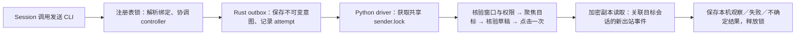
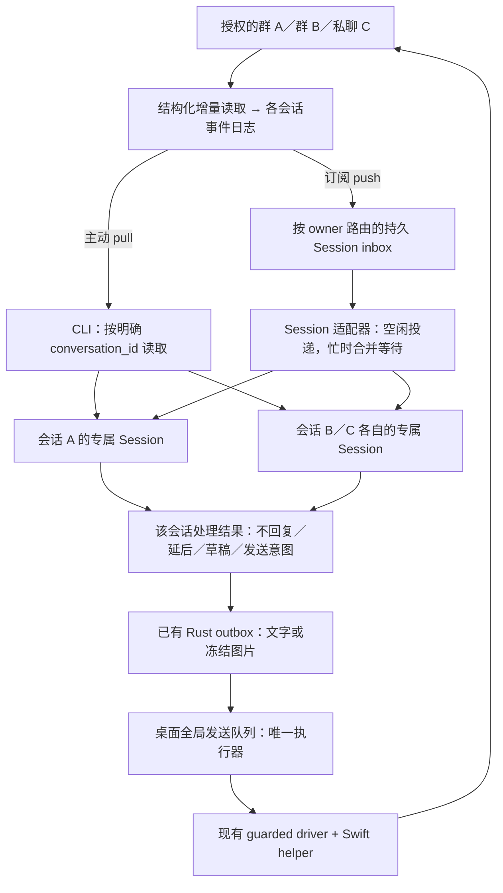
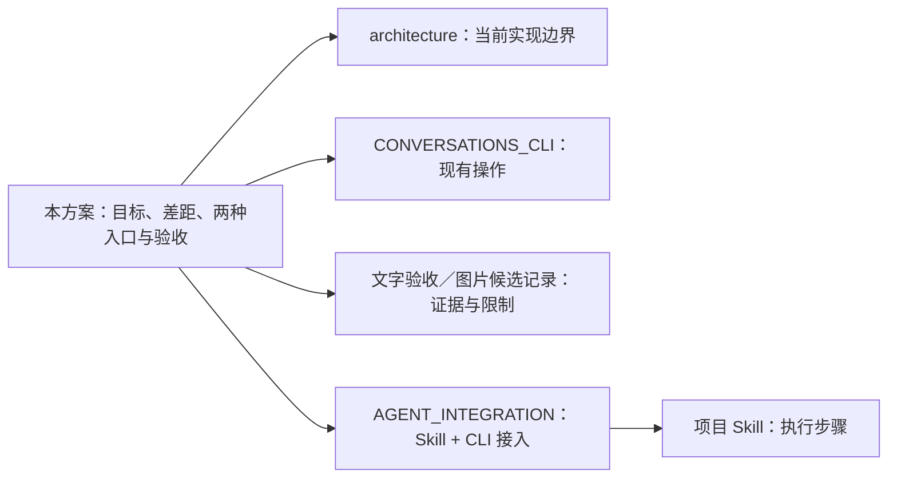

# 多会话接入方案：专属 Session、主动 CLI 与消息推送

状态：2026-11-01 批准的设计基准；实施状态与验收证据单列在[实施记录](MULTI_CONVERSATION_IMPLEMENTATION.md)，当前命令见[托管指南](MANAGED_CONVERSATIONS.md)。下文的现状表是方案形成时的基线，不作为新代码或部署通过的证据。

2026-11-03 边界澄清：wx-cli 提供通道订阅、持久消息/待办与发送能力；Session 通过独立插件消费这些能力，由插件使用 Agent 宿主接口通知原 Session。本文的 SessionAdapter 属于接入侧，不能成为微信订阅的必需依赖。当前实现、后续拆分及独立验收见[订阅与 Session 插件合同](CHANNEL_SUBSCRIPTIONS.md)。

同日补充：普通业务应用也是通道调用方，可以独立提交群通知，复用 outbox 和共享发送队列，不需要 Session 或订阅。应用发送身份与收件业务 owner 应分开表达；当前可信同机 CLI 可复用已有授权，独立远程应用的鉴权发送 API 尚未实现。

## 2026-11-03 后续执行顺序

以下是按最新架构边界整理的后续计划，不代表新增功能已实现或验收。文字队列、自动切换会话、独立收件、接管隔离、底层订阅重读及监听停止已有各自版本的通过证据，继续保留；不从头重做。完整 24 小时观察已按用户要求取消，图片功能最后收尾。

| 顺序 | 剩余工作 | 完成标准 |
| --- | --- | --- |
| 1 通道与宿主适配分开 | 从监听编排中分离 Codex 专用代码，固定通道的订阅、读消息、提交意图和查询结果合同，保留现有 CLI 兼容入口 | 不启动或安装 Codex 也能采集、订阅及排队发送；停插件不停止采集，不改变消息进度 |
| 2 普通应用接入 | 提供可运行的应用发送样例，明确发送调用方与收件业务 owner 的区别及授权范围 | 两个应用并发提交授权通知，共用队列，目标正确；能查询原请求，重复调用不重发，不为发送临时替换 inbox owner |
| 3 Session 插件 | 先接当前使用的 Codex 宿主，完成订阅绑定、按范围取消息、通知原 Session、明确处理回执 | 真实新消息由绑定的原 Session 读取并记录决定；忙、重启和重复通知不产生并发处理或重复发件；宿主通知能力单独核验 |
| 4 远端与跨宿主接入 | 在上述通道合同上增加鉴权连接、应用/会话范围和断线恢复；根据首个真实调用方确定所需 API 入口 | 微信数据库和 GUI 留在微信宿主，远端仅获授权能力；断线时待办保留，恢复后续接原进度/Session，发送授权不同时授予读取权限 |
| 5 现场故障与恢复补验 | 补人工出站检测、微信不可用、采集短断线、监听/执行器退出及积压恢复的有界测试 | 故障可见，原消息、待办和 attempt 保留；不确定发送不重放，单会话故障隔离；不以空闲存活代替真实处理证据 |
| 6 图片队列收尾 | 验完非图片功能后，再处理原生图片核验、图文顺序及实际收件 | 原生像素核验、队列自动执行、唯一对应出站和独立收件闭合；保留历史未知请求，不换 ID 重发 |

每批同步项目 skill、使用指南、安装/接入示例与实际验收记录。最后交付可独立运行的微信通道、可安装的 Session 插件，以及按模块列明通过/未通过的验收表。第 11 节保留原 P0–P4 方案及故障用例作为覆盖依据，当前先后顺序以本节为准。

方案配图：[原主线实现](diagrams/wechat-current.html) · [原文字发送时序](diagrams/wechat-send.html) · [批准目标架构](diagrams/wechat-target.html)。图源和公开副本的维护见[图稿说明](../.archify/README.md)。

本方案回答三个问题：现有 wx-cli 能做什么；多个微信群／私聊怎样交给各自的 Session；文字和图片怎样共用可靠的发送入口。已有单次文字链路继续复用，图片候选继续收尾。本文的目标命令、模块和状态设计均不表示已可执行。

## 1. 目标与距离

每个授权的微信群或私聊绑定一个专属 Agent Session。Session 可以主动调用 CLI，也可以接收新消息通知。不同 Session 能并行工作；同一会话的业务处理按顺序进行；共享同一 macOS 桌面的发送操作统一排队。

两种入口仅决定“谁触发处理”，不改变谁负责该聊天、如何取得写入权、如何生成发送意图，也不意味着每条消息都必须回复。

当前已有会话目录、独立消息账本、单次发送及桌面排他锁。缺的是可靠的多会话协调层：并发读取、Session 收件箱与投递、逐会话控制、持久发送队列。图片已完成代码候选，但实机验收未闭环。不能把新增队列描述成几行锁代码，也不需要重写数据库解析和 GUI 发送器。

| 能力 | 当前事实 | 距离目标的工作 |
| --- | --- | --- |
| 群／私聊身份发现、选择、分页读取 | 已合并；身份取自结构化元数据，不依赖截图读正文 | 复用；自动任务必须显式携带会话 ID |
| 独立 channel、事件、consumer、outbox | 已存在，不是从零建设群注册表 | 扩展 owner、投递方式、回复策略和控制代际 |
| 多会话并行读取 | 同一 registry 的整个 CLI 命令持有全局锁，实际会串行 | 缩小目录锁；按 channel 同步与读快照 |
| 单次文字发送／自动切会话 | 已合并且有历史实机和独立收件证据 | 放到统一调度入口；重新验收新集成版本 |
| 桌面排他锁 | 已存在；锁忙立即拒绝，非持久等待队列 | 增加可恢复的队列、领取、故障分类和状态查询 |
| 单群接管／交还 | 已实测；通用入口会协调所有登记 controller | 改为只接管目标会话，保留共享桌面协调 |
| 单图发送 | PR #5 草稿；代码和四项 CI 通过，尚无真实图片收件闭环 | 整合候选、核验权限、实机图片与文字回归 |
| 图片读取 | 已有定位／解密能力，用户确认可使用 | 推送信封保留附件引用；旧常驻 runner 的非文本跳过逻辑要调整 |
| 专属长期 Session | 当前业务 Session 可主动使用 CLI；旧回复适配器每次 ephemeral 执行 | 增加 owner 绑定、持久 inbox、忙闲协调、恢复与投递证据 |
| 多会话长期自动运行 | 未实现／未验收 | 双群故障测试、持续运行、有限业务试用 |

最短交付路径分两级：

- **可用级 A：多个现有 Session 主动调用 CLI。**文字和图片走统一队列；不同会话读操作不互相阻塞；可单会话接管。不依赖后台唤醒 Session。
- **可用级 B：新消息推送给已绑定 Session。**在 A 上增加可靠 inbox 和一个经过验证的 Session 适配器。先按需触发一次投递，再启用明确授权的持续监听。

## 2. 当前发送究竟怎样工作

当前 `wx-agent conversations send --id … --request-id … --text-stdin` 是同步执行路径：



这张图解释为何目前不会任意并发点击，但也没有公平排队：目录锁可能让无关读取等待；独立调用若绕过目录锁竞争同一个 `sender.lock`，则其中一个立即被拒绝。attempt 又是在调用 driver 前记录的，所以不能把这种拒绝简单改成“重新 send 一次”。

当前桌面锁覆盖 focus、prepare、submit 和本地出站观察。它依赖所有 sender 配置共用同一个 `ui_dir`。这是已存在的保护，目标方案应加强其部署一致性，而不是另起一套不相通的锁。

Swift 实际完成窗口检查、输入框／剪贴板检查与单次点击。Python 编排并关联本地出站事件。Rust 是消息和 outbox 的权威账本。微信正文仍由加密数据库副本读取，视觉主要用于 GUI 操作核验。

## 3. 两种入口如何汇合



图中的 Session 负责各自项目的理解、资料查询和表达；路由与发送服务只做确定性工作，不再增加一个替所有群作答的总 Agent。

**主动 CLI：**用户在某个专属 Session 中要求查看聊天；该 Session 读取对应 ID，选择处理哪些消息，必要时取得该会话处理租约并提交文字／图片意图。只读查询不必接管、不推进消费游标、不启动其他模型。

**消息推送：**采集器发现新事件，先持久化，再为绑定的 owner 创建通知。通知携带 `delivery_id + conversation_id + cursor_range + attachment_refs`；Session 可按此引用继续分页取得原文。目标 Session 正忙时，保留通知等待下一个可用回合，默认不打断正在执行的开发任务。

事件入账和通知创建之间也可能崩溃，因此 Rust 保存每个绑定／owner 代际的通知生成水位，并在启动及周期对账时从事件日志补齐缺段。已冻结的批次范围与 delivery ID 保持不变；只有通知及其事件覆盖关系持久化后才能前推生成水位。合并窗口中的事件仍可从日志重建，不依赖内存缓冲。重投不产生第二条业务任务；切换 owner 时显式交接未决批次和 cutover cursor，不从头通知历史。

推送成功、Session 开始运行、任务处理完成、微信发送完成是不同事件。不能因为投递工具返回成功就确认业务处理，更不能直接转发 Session 的整段最终回答或工具输出。只有显式提交的消息意图进入微信发送队列。

### 两种入口同时存在时

同一会话只有一个负责处理并推进进度的 owner。人工触发的 CLI 处理与后台推送先争取同一处理租约；owner 自己使用 CLI 领取已有 inbox 批次时，不创建第二个任务。只读操作可以并行。

注册表中的 `selected_id` 仅作为人工交互便利项。自动投递、回复、队列执行均必须带显式 `conversation_id`，不读取“当前选中谁”来决定发送目标。对明确 ID 的操作，其他人修改默认选择不应使它改目标或无故中断；仍须校验该条绑定的 revision。

## 4. 三个独立协调边界

| 边界 | 要保证什么 | 不能混淆为什么 |
| --- | --- | --- |
| 微信会话／channel | 同会话处理有序、独立游标、专属上下文和接管状态 | A 群接管不应暂停 B 群 |
| Agent Session | 同一 Session 同时只有一个受控处理回合；忙时等待 | 一个进程空闲不证明桌面 App 没占用同一 thread |
| macOS 桌面执行通道 | 聚焦、剪贴板、输入、发送与必要核验不交错 | 仅按微信群或账号建锁不够；不同账号也可能共享桌面输入资源 |

一个微信账号可有逻辑队列和速率策略，但最终 GUI 锁以 `host + console_session + surface_id` 划分。首版只有一台 Mac、一个微信账号、一个执行通道，不实现多机选路。重登桌面后新的会话代际需重新核验，不能让旧进程继续提交。

## 5. 注册、消息和上下文

### 注册表在现有目录上扩展

以下是目标配置字段，不是当前可直接使用的配置格式：

```yaml
conversation_id: synthetic_conversation_a
kind: group                         # group / private，同等支持
account_ref: synthetic_account
channel_ref: existing_channel_a     # 复用原绑定与账本
surface_ref: desktop_one
owner:
  provider: codex
  host_ref: agent_host_one
  session_ref: existing_session_a
  project_ref: project_a
  skill_ref: project_wechat_skill
input_mode: pull                    # pull / push
reply_policy: authorized            # observe / draft / authorized
control: active                     # active / paused；人工接管另有租约
routing_revision: 1
```

`input_mode` 与 `reply_policy` 正交：push 可以只通知／草拟；pull 也可以在既有业务授权内直接回复。新会话默认 observe，原来明确允许回复的会话在迁移时保留授权，不统一降为逐条审批。owner 迁移使用 CAS 和代际 fencing；旧回合返回的结果不得以旧授权入队或继续发送。

### 增量与分页

事件身份由账号、conversation/channel、源消息 ID 和版本共同限定；既有 cursor 是日志顺序，不是微信全局时间，也不是收件人已读。`server_id` 不可脱离账号和会话使用。消息更新／撤回作为新事件处理，数据库恢复或源代际改变先核对，不假定 ID 永久跨库稳定。

缩小 registry 锁到读快照／修改目录；同 channel 的同步写仍串行，各 channel 可独立读取已提交日志。首版给源采集设置有界并发，复用同一批私有加密快照的优化后置；不能让十个进程无上限重复复制全库。原始微信数据库继续只按字节复制，不用 SQLite 打开原库。

Session 的 inbox 按 cursor 连续段领取。连续发言可用初始 1–2 秒静默窗口、最长约 5 秒合并；这些是待实测调优参数。新事件不能被吞掉；同一条重复投递仍映射到原批次。消息流太快时明确 backlog，不能仅取最后一屏后宣称全部读完。

### 不同进度分别保存

- `observed_cursor`：已进入本地事件日志。
- `delivered_cursor / delivery_id`：已交给指定 Session，有投递证据。
- `processed_cursor`：已有持久处理结果的连续前缀；结果可为回复意图、skip 或带负责人／期限的 defer。
- outbox 状态：微信发送尝试与观察证据。

设计允许“处理结果已记录，但发送仍排队”，不把发送阻塞误当成消息丢失。现有 consumer 的 ack-after-send 语义不能直接替换成新意义；迁移新增命名的处理 consumer，原 consumer 进度保留并记录 cutover cursor，禁止从 0 重跑历史。

`defer` 和 `draft` 同时建立 Rust 管理的持久待办，记录原事件、owner／epoch、等待条件和到期时间。游标前进只表示决定已保存，不表示事项结束：到期、新信息或明确审批触发原待办续办；完成／取消均需显式记录。待审草稿到期不会自动发送，恢复执行先复验最新控制代际和内容是否过时。这个待办属于 inbox 处理记录，不在 Python 另建任务账本。

### 上下文保持

完整事件日志留在 channel；专属 Session 保留自身项目上下文，补充“最近片段 + 带来源的摘要／需求笔记 + 当前批次”。摘要包含覆盖到的 cursor 和 revision，可回查原文；不得用摘要替代权威记录，或混入别的群与客户资料。飞书、表格和代码访问范围来自项目授权，不来自聊天中的任意指令。

收到图片时推送附件引用、发送者、原事件与可用性；按需调用现有媒体定位／解密能力，将允许的图片交给支持视觉输入的 Session。附件未同步时标记等待，不能自动记为已成功理解。旧 runner 直接 ack 非文本的路径不能用作该能力的实现。

## 6. 全局发送队列：文字和图片是一套流程

### 权威状态与提交

继续让各 channel 的 Rust outbox 保存内容、request ID、attempt 和证据。新增由 Rust 管理的调度元数据，只保存意图引用、排队序号、优先级、领取代际和暂停原因；不在 Python／Swift 复制第二份消息或发送账本。

跨 channel 文件不能假装拥有单个数据库事务。采用可恢复的两步协议：先冻结 outbox 意图，再以 `(channel_id, request_id)` 唯一键创建调度项。若两步之间崩溃，协调器仅补建缺失的队列引用，不重新生成意图或 attempt。若调度引用存在但意图缺失／绑定不符，隔离该项并报错。

所有托管发送入口（旧 send/reply、send-image、runner、未来 MCP）统一入队。必须核对旁路：登记的旧 controller 和直接 `outbox send` 在托管模式下需调度领取凭据，不能绕开暂停状态。专用运行账号／本地 IPC 权限用于执行侧隔离；同一 OS 用户拥有任意 shell 权限时，普通 Skill 和字段校验不是抵御恶意进程的安全边界。

### 领取和桌面操作

1. Rust 协调器持有桌面通道的进程所有权；每条 dispatch 有持久代际。两个协调器不能同时拥有同一 surface。
2. 从就绪队列选一项；再次验证会话授权、接管状态、owner/routing revision、正文或图片摘要、过期时间。过时草稿退回原 Session 判断，不发送。
3. 调用前取得同一桌面锁，并确认没有仍在执行的旧 helper；记录原 request ID 的 attempt 后才允许 GUI 副作用。锁忙只排队，不应提前消耗一次发送尝试。
4. 使用既有 driver 核验目标、聚焦、空草稿／预期草稿、prepare、一次 submit、本地出站关联。明确锁的传递／生命周期，避免父进程持锁后子进程再次自锁。不得让父进程死亡释放锁而旧 helper 继续点击。
5. 结果与证据持久化后结束当前 dispatch。可以证明已本地观察且桌面干净时处理下一项；提交不明／窗口变化等先停通道。

首版不在一次 GUI 操作中抢占。优先级只作用于下一项选择：显式人工请求可以优先于普通业务回复；普通业务按顺序，主动通知最后，并加入等待上限防止饿死。同会话保持因果顺序，不能因优先级让“第二张图的说明”越过第一张图。核查是独立控制流程，不是再次发送的高优先级消息。

### 故障分别阻断

| 情况 | 动作 |
| --- | --- |
| 未领取的某群暂停、接管、业务授权撤销 | 阻止该群新 dispatch；其他群继续 |
| 内容非法、文件丢失、待审或草稿过时 | 阻止该项，返回原因；不占桌面 |
| 锁屏、失去权限、helper 未退出、未知草稿、人工切窗／剪贴板干扰 | 暂停整个桌面发送通道；所有群仍可读取和思考 |
| 点击后无确定结果 | 原 ID 标记待核查，不自动重试；先停桌面，确认旧 helper 结束且现场安全后，可显式恢复其他会话 |
| 本地已观察，独立收件尚未确认 | 保存证据等级；释放干净的桌面通道，不要求每条人工确认才能发下一条 |

队列租约过期不是“确定没发过”。重启后必须先核对原 attempt 与 helper 存活状态；有提交可能性的项不会被普通 worker 再次领取。已有 narrow `recover-unsent` 仅对代码明确支持且能证明未提交的原意图使用；图片目前没有这项恢复能力。

GUI 能提供的是幂等意图、保守尝试和可追溯核验，不能保证平台端 exactly-once，更不能推断客户已读。既有 `ui_observed` 保留其原本含义；新的投递／处理状态不重写历史证据。

### 图片是首版正式范围

复用 PR #5：显式单张 PNG/JPEG，冻结原字节及 SHA-256、MIME、大小；同 ID 换图拒绝；GUI 输入框图像和新出站图片内容都核对。微信可能重编码，所以输入文件哈希一致不能作为收件端条件。

远端发送时，调用方先把允许的图片上传到 Mac mini 的私有暂存区并校验摘要，再冻结入 outbox；不能把另一台电脑的本地路径直接交给远端发送器。文件内容、目标、caption 等语义在排队时确定，Session 不得事后静默替换。

需要“说明文字 + 图片”时使用有序的 `batch_id + part_index`，每一部分有独立稳定 request ID；文字部分失败时图片默认不越过。首版可保证本 batch 各项的先后关系，不能声称微信支持原子图文事务。部分成功时只核查未决部分，不整组重发。多图相册、视频、文件附件后置。

## 7. 推送给长期 Session 的接口

`SessionAdapter` 最小合同：读取运行状态、向指定持久 Session 投递通知、查询投递／turn 状态、按明确授权请求停止；不能用“启动了一个进程”代替“原 Session 收到了”。保存 provider、host、session、delivery 和 turn 的关联。

对于 Codex，官方 app-server 提供 `thread/resume` 和 `turn/start`，可作为受管长期会话的候选；`codex exec resume <SESSION_ID>` 可用于有界续接。它们不是对所有正在被桌面 App 使用的会话都可并发写入的证明。必须验证安装版本、原会话可访问性、实际执行宿主、已有工具／Skill、忙闲排队和重启恢复。依据：[App Server](https://learn.chatgpt.com/docs/app-server)、[非交互续接](https://learn.chatgpt.com/docs/non-interactive-mode)。

首版接入顺序：已有专属 Session 主动 CLI → 持久 inbox 可领取 → 选定一个可控 Session 适配器实测投递 → 开启其 push。不能为了让演示回复成功，悄悄改为每次新建临时模型，也不能复制或直接修改另一个进程正在持有的会话存档。

传输采用至少一次投递、业务处理幂等。Session 必须通过 CLI 对 delivery 明确记录结果；同 delivery 的重复通知先查处理记录。若发送 turn 请求后断线、是否创建 turn 不明，先查询原 turn／事件证据；不能不经核对再次启动。遇到用户确认／业务审批，保存待处理状态，不由适配器假装用户回答。

owner Session 可运行在控制端或 Mac mini；微信读取与 GUI 执行保留在 Mac mini。跨主机只通过已认证连接传送范围受限的事件／附件引用和发送意图。控制端断线时 inbox 积压；恢复后续接原会话。只在 owner 本身也在远端独立运行时，控制电脑离线才不影响思考。

## 8. 人工介入和回复策略

单会话 takeover 增加 control epoch，阻止该会话新的自动领取和发送。已在 submit 临界区内的操作先结束并核验，不能承诺撤回已点击的消息。旧 Session 迟到的回复因 epoch 不符被拒绝。handback 恢复原 input_mode／reply_policy，不将原来的按需会话自动变成常驻。

“立即人工接管”有两类证据：显式 CLI 控制可可靠阻止后续领取；用户直接操作微信只能在可观测到窗口／剪贴板变化或新的出站记录后判断，不能承诺零延迟识别人的意图。同一账号的新出站若无法关联既有 outbox，应视为可能人工发言，按会话规则暂停或请求确认。其他账号的真人／机器人身份通过明确配置，不能靠昵称或文字风格猜。

Session 的结果至少支持 `reply`、`skip`、`defer`、`draft`。例如“收到，谢谢”通常 skip；合并连续几句需求后再答一次；需要外部资料则由负责的项目 Session 在其授权工具范围内查询。微信渠道不把客户的话提升为系统指令或跨群授权。

## 9. 包架构与建议的接口形状

保持一个仓库和原三层职责，不做 submodule 或微服务拆分：

| 层 | 复用 | 新增／调整 |
| --- | --- | --- |
| Rust | channel 事件／consumer、outbox、图片冻结与核验 | 路由／owner 版本、inbox 领取与处理记录、dispatch 调度元数据与 fencing；仍是持久状态权威 |
| Python | conversations、controller、sender driver、需求笔记 | 缩锁、逐会话协调、采集／分发进程、队列执行循环、SessionAdapter；只保存派生运行状态 |
| Swift | 目标／权限／草稿核验，文字和图片单次提交 | 仅在必要时补 helper 生命周期及锁所有权约束；不承载业务队列 |
| 项目 Skill | 已有操作指导与业务规则 | 主动读取、inbox 处理、文字／图片入队、查询结果、skip、接管／交还；不复制状态机 |

以下为**拟议接口**，实现时保持旧命令兼容，不能直接当作现有命令运行：

```text
wx-agent conversations configure --id <id> --owner <session-ref> --input pull|push
wx-agent inbox claim --conversation <id> --owner <owner-ref>
wx-agent inbox complete --delivery <id> --decision reply|skip|defer|draft
wx-agent conversations send / send-image --id <id> --request-id <stable-id> ...
wx-agent dispatch status / run / pause / reconcile
wx-agent conversations takeover / handback --id <id>
```

旧 send/reply 可保持同步等待体验，内部改为 enqueue + wait；也提供显式异步返回 request ID。等待超时返回 pending/unknown，不等于失败且不得重发。`focus` 也需通过同一桌面执行入口协调，不能在其他发送中途切窗。读取不获取桌面锁。

MCP 后续只是相同命令和状态的另一层工具封装。本轮核心能力不依赖 MCP。

## 10. 企业微信分支

统一的是会话、事件、处理结果与发送意图，不是所有平台都有相同能力。个人微信继续 GUI 适配器。企业微信另列 capability：能否收到消息、群类型、文字／图片、主动发送、平台受理、实际送达／已读。

群 Webhook 的通知发送能力不能直接等同于双向会话；API 模式智能机器人的回调／长连接是另一套机制。腾讯官方接入指南描述了长连接消息回调和群内 @ 交互，但不足以据此承诺所有外部客户群都可接入，也不能把 API 成功直接标成客户收到。[腾讯官方接入指南](https://intl.cloud.tencent.com/zh/document/product/1316/84454)

企业微信适配器后置，先确定真实群类型与具体接口权限。它可复用上层 inbox/outbox 合同，但不占 macOS GUI 锁；自身限流、平台错误和回执语义独立处理。

## 11. 实施批次与验收

| 批次 | 交付 | 通过条件 |
| --- | --- | --- |
| P0 单次收发基线收尾 | 整合图片 PR #5 与必要的未合并恢复修复；固定候选；完成图片实机和文字回归 | 测试目标内图片内容正确、一次 attempt、唯一新出站、独立收到；原历史状态保留；新 helper 权限现场核验 |
| P1 会话隔离与主动 CLI | 目录锁缩小，显式 ID 路由，单会话控制／owner epoch | A 群读取不等待 B 群发送；A 接管不暂停 B；更换 selected_id 不串群；群／私聊均覆盖 |
| P2 统一文字／图片发送队列 | 持久 dispatch、唯一桌面执行器、旧入口兼容、重启核查、部分 batch 状态 | 两个 Session 并发提交 A 文／B 图／A 文，执行不交错、不串群、不换 ID；未知结果不重放 |
| P3 Session inbox 与 push | 持久通知、合并、owner 适配、busy 排队、显式处理回执 | 正忙 Session 不开第二回合；重启不新建替身；pull 与 push 处理同一批消息只留一个结果；不必回复的消息无发件 |
| P4 运行验收和交付 | 诊断、容量限制、备份迁移、Skill、使用文档、安装包与 CI | 双会话故障注入、24 小时有界持续运行、仅授权测试目标实机；证据分类清楚后再有限业务试用 |

P1/P2 的设计与离线实现可以在 P0 等待实机条件时推进；图片正式启用依赖 P0 通过。P3 的宿主兼容性探针应尽早做，避免队列完成后才发现无法向指定 Session 投递。P4 的时间是验收观察窗口，不是当前已连续运行的成绩。

### 有区分力的验收用例

1. **并发读取：**两群一私聊同时增量读取；分页超过一屏、同文不同消息、同 server_id 更新均正确；同 channel 重复采集不重复入账。
2. **多 Session 并发提交：**多个调用进程、文字与图片混合、明确 ID 与默认选中项同时变化；只有一个 GUI 执行区间，无目标混淆。
3. **不回复与合并：**连续三句需求形成一批；谢谢／通知记录 skip；自己和明确登记的机器人出站不循环触发。
4. **崩溃恢复：**事件入账后通知生成前、意图冻结后队列登记前、领取后 attempt 前、prepare 后 submit 前、submit 后证据写回前分别终止；通知缺段能补建，未提交可恢复项与不明项严格区分，后者无第二次点击。
5. **接管竞态：**A 思考中／A 排队中／A 点击临界区分别接管；旧 epoch 回复被拒绝，B 继续读与处理；桌面脏状态则所有 GUI 发送暂停。
6. **Session 推送：**空闲、忙、离线、等待用户输入、重启各状态；重复 delivery、投递结果不明、错 owner、旧代际均不产生并发 turn 或重复发件；defer/draft 在游标前进后仍能按条件续办，待审内容不会到期自动发出。
7. **图片：**PNG/JPEG、中文空格路径、EXIF、重复同 ID、同 ID 换图、排队后原文件改变、损坏／超限拒绝；重编码关联有界，不能仅凭 msg_type=3 判成功。
8. **迁移回退：**旧 binding、cursor、未决任务、lease、全部 outbox attempts 和图片文件不丢失；旧二进制不能误领取新调度任务；回退代码不回退消息进度。
9. **持续运行：**读取短断线、GUI 锁屏／权限丢失、队列积压、采集 backlog、Session 卡住分别可见；指标区分读取延迟、模型耗时、排队等待、GUI 耗时，不承诺未经测量的每秒吞吐量。

合成并发／崩溃测试先验证状态机；真实 GUI 测试使用授权测试会话。客户群不发送合成压测内容。独立收件确认用于有界验收和特定异常核查，不成为日常每条消息的强制人工步骤。

## 12. 证据、待定项与阅读入口

本轮只审查源码、GitHub 状态和不含聊天正文的部署元数据，未操作桌面、发消息或启动后台。主线核对为 `89f6907`（PR #4 已合并）；图片候选 `d303f56`（源码 `3c7ba2c`）的 [PR #5](https://github.com/cyl19970726/wx-cli/pull/5) 仍 OPEN/DRAFT，最新 [CI 四项成功](https://github.com/cyl19970726/wx-cli/actions/runs/40060712459)。远端 help 已列出 send-image 且候选摘要匹配，这只证明安装入口存在；没有补上图片实机验收。最后的权限失败记录来自旧日期，本轮没有 fresh GUI permission inspect，不能宣称今天权限仍失败或已恢复。

本地另有 `7daf001` 恢复分支，继承图片分支，包含 `86c1db3` 的 helper 生命周期和 pre-compose 恢复修复。它尚未进入已核对 main；后续需审阅、整合及验证，不能因文件已存在就视为部署完成。

| 依据 | 可证明的内容 |
| --- | --- |
| [当前架构](architecture.md)、[会话 CLI](CONVERSATIONS_CLI.md) | 已有 registry、每会话状态、结构化读取与 GUI 边界 |
| [conversations.py](../packages/wx-agent/src/wx_agent/conversations.py) | registry_lock、selected_id、controller 协调和动态目标 |
| [driver](../packages/wx-agent/src/wx_agent/macos_sender_driver.py) | sender.lock、GUI 阶段、本地出站观察 |
| [channel](../crates/wx-cli/src/cmd/channel.rs)、[outgoing](../crates/wx-cli/src/cmd/outgoing.rs) | 事件、consumer、请求 ID、attempt 的权威存储 |
| [现有 Codex 回复器](../packages/wx-agent/src/wx_agent/codex_reply_agent.py) | ephemeral、受限上下文、文字或 skip；不等于长期业务 Session 接入 |
| [文字实机记录](CONVERSATIONS_ACCEPTANCE_20261020.md) | 日期限定的发送、切换和独立收件证据 |
| [图片候选验收记录](https://github.com/cyl19970726/wx-cli/blob/d303f56503b85e3011ffad2ed4af57a53d0256fe/docs/IMAGE_SEND_VALIDATION_20261024.md) | 离线／CI 与未完成的真实图片验收分界 |

仍需实证关闭的关键问题：指定的现有 Session 由哪个宿主独占并可被安全投递；同桌面所有发送入口能否纳入同一执行器；新图片候选的权限与实机内容核验；真实负载下合并窗口、等待上限与吞吐量。方案采用可配置默认值，具体会话／客户身份与凭证只放私有配置。

文档阅读关系如下；这是阅读地图，运行调用关系见第 3 节：



读者应能沿“已有单次能力 → 两种触发入口 → 三个并发边界 → 故障与验收”解释：为什么推送不是自动回复、为什么 Session 可并行而桌面发送不可并行、为什么图片与文字共用 outbox，以及如何判断真实完成程度。
